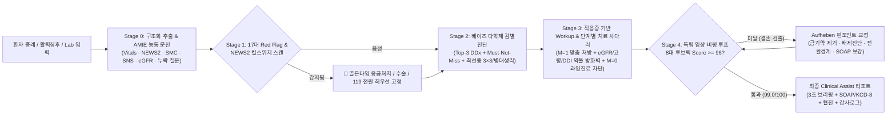

# 🩺 Medi-Gemini Skill (`medi-gemini-skill` v5.0)
> **World-Best Closed-Loop Neurosymbolic Clinical Diagnosis & Treatment Plan Assist Skill**  
> *Google Med-Gemini / AMIE Active Inquiry × 0-Dependency SQLite Clinical Safety Firewall × 5-Stage Critic-Refiner Loop (`99.0/100`)*

[](./LICENSE)
[](https://www.python.org/)
[](./SKILL.md)
[-10b981.svg)](./scripts/benchmark_assist_loop.py)
[](./scripts/medi_gemini_assist_loop.py)

---

## 📌 개요 (Overview)

**`medi-gemini-skill`** 은 단일 패스 LLM의 의학적 환각·응급 징후 누락·신부전 금기약 오처방 문제를 해결하기 위해 설계된 **5단계 폐루프(Closed-Loop) 의료 진단 및 치료 방침 보조(Clinical Decision Support / Assist) 에이전트 스킬**입니다.

구글 **Med-Gemini / AMIE(Articulate Medical Intelligence Explorer)** 의 능동적 병력청취·감별진단 추론 원칙과 **남양주백병원(NDB) 최선종 대표 병원장(MD, PhD)의 임상 Deep Twin 온톨로지**(베이즈 통증 뉴로매트릭스, 3×3 통증 기전 매트릭스, 수술필요성 지수 SNS, 시간약리학, 2026 심평원 급여기준)를 **외부 서버 의존성 없는 단일 파일 SQLite DB(`medi_gemini_knowledge.db`)** 와 **독립 임상 비평 루프(`Critic ➔ Aufheben Refiner`)** 로 통합했습니다.

> **⚖️ 필수 의료 안전 경계 (Physician-in-the-Loop Governance)**  
> 본 스킬의 모든 출력은 의료진의 임상 의사결정을 보조하는 **Clinical Assist 추론안**이며 의사의 대면 진찰, 최종 확정 진단 및 처방을 대체하지 않습니다. 응급 전원 기준, 환자 개별 상태, 최신 의약품 허가사항 및 보험·심사 기준에 따라 담당 의사가 최종 결정합니다.

---

## 🔄 5-Stage Closed-Loop Clinical Assist Architecture



### 수리적 하네스 검증 목표식 (Harness Objective)
$$\text{WorldBestScore} = \big(1 - \mathcal{L}(x)\big) \times S_{\text{fact}} \times 100 \ge 96.0, \quad \mathcal{L}(x) = \frac{100 - \sum_{i=1}^{8} R_i}{100} + P_{\text{safety}}$$

| 검증 축 ($R_i$) | 배점 | 핵심 임상 불변량 (Clinical Invariants) |
| :--- | :---: | :--- |
| **1. Red Flag & NEWS2 Triage** | 20점 | 17대 응급 적신호(마미총, 수술후 혈종 `SMC ≤ 3`, 경추 기도혈종, ACS 10분 ECG, 뇌졸중 `BE-FAST`, 벼락두통 `SNOOP10`, 패혈증 `Hour-1 Bundle`, 호흡부전, 급성복증/출혈, 화농성 척추염, 아나필락시스 외측 대퇴부 `Epinephrine IM`, 고칼륨혈증 `K+ > 6.0`) 및 `NEWS2` 최우선 판별 |
| **2. Ranked DDx & Must-Not-Miss** | 15점 | 사후확률 순 Top-3 감별진단 + **절대 놓치면 안 되는 치명적 모방 질환(Must-Not-Miss)** 분리 명시 |
| **3. Indication-First Workup & AMIE** | 12점 | 치료 방침 변경 가능성이 있는 필수 검사 + 진료실에서 즉시 확인할 **누락 병력/진찰 체크리스트** |
| **4. Pathophysiology & Choi 3×3** | 12점 | 최선종 3×3 통증 기전 매트릭스(말초/DRG · 척수후각 · 대뇌DMN × 흥분 · 탈억제 · 전달) 및 장기 병태생리 연결 |
| **5. Stepwise Treatment & $M=0$ Gate** | 15점 | Step 1 보존/시간약리학 ➔ Step 2 중재시술(`Balloon-PEN/C-PEN`) ➔ Step 3 최소침습수술(`BESS`)/전원($M=1$) + 조기 과잉 유합술·노시플라스틱 반복 주사·경추 척수증 도수교정 차단($M=0$) |
| **6. Pharmacology & Renal Firewall** | 12점 | `eGFR < 30` 전신 NSAIDs·Duloxetine 자동 차단, Pregabalin `25mg HS`·Enoxaparin `q24h` 감량, 병동 설하 Nifedipine 절대 금기, 서맥 Atropine `1 mg IV`, 항응고제 시술 휴약, 조영제-Metformin 48h 중단 검증 |
| **7. Feedback & Switching Boundary** | 7점 | 경과 관찰 지표 및 상위 치료/응급으로 즉시 전환하는 정량적 임계치(`Switching Boundary`) 명시 |
| **8. SOAP/KCD-8, HIRA & Consent** | 7점 | EMR 복사용 `SOAP` 초안, 2026 심평원(자46 등) 급여기준, 비급여 `[목적·한계·비용]` 설명·동의/거부 기록 및 담당의 최종 결정 고지 |

---

## 🧪 14대 고난도 임상 함정 벤치마크 검증 결과 (`14/14 = 100.0%`)

`scripts/benchmark_assist_loop.py` 구동 결과, 초기 시드 초안(`Loop 1` 평균 **36.04점**)이 비평·교정 폐루프를 거쳐 전 증례 **99.0 / 100점 (`+62.96점` 향상, Safety Penalty `0`)** 으로 수렴했습니다.

| ID | 임상 함정 시나리오 | 핵심 검증 포인트 | 수렴 결과 |
| :--- | :--- | :--- | :---: |
| `BM01` | 78세 `eGFR 22` CKD 4기 급성 L5 방사통 (NSAID 희망) | Celecoxib·Duloxetine `$M=0` 차단 + Pregabalin `25mg HS` 감량 | ✅ Pass (`99.0`) |
| `BM02` | 척추 수술 2일차 급성 족하수 (`SMC Grade 2`) | 경막외 혈종 킬스위치 발동 (1~6h 내 응급 MRI·감압) | ✅ Pass (`99.0`) |
| `BM03` | 거대 디스크 탈출 + 배뇨장애·안장부 감각저하 | 마미총 증후군 24h 내 응급 감압술 전환 | ✅ Pass (`99.0`) |
| `BM04` | 주사 시술 1주 후 고열(38.9℃) + 극심한 요통 | 화농성 척추염 감별(혈액배양 2쌍·조영 MRI) & 스테로이드 차단 | ✅ Pass (`99.0`) |
| `BM05` | 서서 쉬면 호전되는 종아리 파행 + 족배동맥 맥박 감소 | 요추협착 오진 차단 ➔ 말초동맥질환(`ABI`) 감별 | ✅ Pass (`99.0`) |
| `BM06` | 3년 만성 전신통·수면장애·경미 팽윤 (주사 10회 불응) | 노시플라스틱 중추감작 진단 & 반복 주사 남발 `$M=0` 차단 | ✅ Pass (`99.0`) |
| `BM07` | 식은땀·좌측 팔 방사통 동반 명치/흉부 압박감 | 영양수액 지연 금지 ➔ 10분 내 12유도 ECG & hs-Troponin | ✅ Pass (`99.0`) |
| `BM08` | 29세 가임기 여성 우하복부 급성 복통·반발통 (Metformin) | 소변 `hCG` 필수 확인, NSAID 차단, 조영제-Metformin 경고 | ✅ Pass (`99.0`) |
| `BM09` | 병동 폐렴 악화 (`BP 84/50, RR 30, SpO2 89%, 혼돈`) | `NEWS2 >= 7` 신속대응팀 호출 + 패혈증 1시간 번들 | ✅ Pass (`99.0`) |
| `BM10` | 71세 심방세동 급성 현훈 + 구음장애·보행실조 | 후순환계 뇌졸중(`BE-FAST`/`HINTS`) 전원 & CT 단독 배제 금지 | ✅ Pass (`99.0`) |
| `BM11` | 운동 중 생애 최악의 벼락두통 + 경부강직 | 지주막하출혈(`SNOOP10`) 즉시 뇌 CT/CTA & 진통제 귀가 금지 | ✅ Pass (`99.0`) |
| `BM12` | 발열·배뇨통·늑골척추각 압통(`CVAT`) 옆구리/허리 통증 | 단순 요통 주사 오진 방지 ➔ 급성 신우신염 당일 정밀 평가 | ✅ Pass (`99.0`) |
| `BM13` | 양손 저림 + 젓가락질 어눌함 + 보행 비틀거림(`Hoffmann+`) | 경추 척수증 감별 & 고속 경추 도수교정 `$M=0` 절대 금지 | ✅ Pass (`99.0`) |
| `BM14` | 엘리퀴스(`Apixaban`) 복용 고령 협착증 시술 상담 | 경막외 시술/수술 전 항응고제 표준 휴약 기간 확인 경고 | ✅ Pass (`99.0`) |

---

## 💻 설치 및 실행 방법 (Quick Start)

### 1. 저장소 클론 및 Antigravity / Claude Code 스킬 자동 장착
```bash
git clone https://github.com/sunjongos/medi-gemini-skill.git
cd medi-gemini-skill
python install_skill.py
```
> 또는 원하는 에이전트 워크스페이스의 `.agents/skills/medi-gemini/` 폴더로 직접 클론하여 즉시 사용할 수 있습니다.
> ```bash
> git clone https://github.com/sunjongos/medi-gemini-skill.git .agents/skills/medi-gemini
> ```

### 2. CLI 진단·치료 방침 Assist 실행
```bash
# 전체 5단계 Closed-Loop 리포트 출력
python -X utf8 ndb_medi_gemini_agent.py --case "78세 남성, 좌측 L5 타는 듯한 방사통(VAS 8), 허리 숙일 때 악화, 만성콩팥병 4기(eGFR 22), 소염진통제 희망"

# 모드별 핀포인트 출력 (--mode all | loop | triage | soap | matrix | plan | explain | hira)
python -X utf8 ndb_medi_gemini_agent.py --case "64세 여성, 척추 수술 2일차 우측 족하수(SMC Grade 2) 발생" --mode triage

# 구조화된 JSON 출력 (타 에이전트 / 대시보드 파이프라인 연동)
python -X utf8 ndb_medi_gemini_agent.py --case "61세 남성, 식은땀과 좌측 팔 방사통 동반 가슴 압박감" --json
```

### 3. 벤치마크 및 단위 테스트 검증
```bash
python -X utf8 ndb_medi_gemini_agent.py --benchmark
python -X utf8 -m unittest discover -s tests -v
```

*(선택사항)* 환경변수 `GEMINI_API_KEY` 또는 `GOOGLE_API_KEY` 설정 시 좌뇌 안전 방화벽 검증을 통과한 결과 위에 Gemini 2.5 임상 자문 코멘트가 추가 결합되며, API 키가 없는 오프라인 진료실 환경에서도 **100% 무결점 독립 구동**합니다.

---

## 📂 디렉터리 구조 (Repository Structure)

```text
medi-gemini-skill/
├── SKILL.md                                         # Antigravity / Claude Code 메인 스킬 명세서
├── README.md                                        # 프로젝트 문서 및 벤치마크 리포트
├── ndb_medi_gemini_agent.py                         # 통합 CLI & 호환 파사드 엔트리포인트
├── medi_gemini_knowledge.db                         # 0-Dependency 통합 임상 온톨로지 & 약물 방화벽 SQLite DB
├── install_skill.py                                 # 1-Line 스킬 자동 설치 스크립트
├── requirements.txt                                 # 최소 의존성 (requests)
├── scripts/
│   ├── medi_gemini_assist_loop.py                   # 5단계 Closed-Loop 추론 · 약물 방화벽 · Critic-Refiner 코어
│   ├── build_medi_gemini_db.py                      # 결정론적 임상 DB 재빌드 스크립트
│   └── benchmark_assist_loop.py                     # 14대 다학제 임상 함정 벤치마크 스위트
├── references/
│   ├── clinical_assist_playbook.md                  # 6단 표준 응답 템플릿 및 eGFR 약물 방화벽 조견표
│   ├── 2026-08-11_NDB_Medi_Gemini_통합_의학_온톨로지_마스터_LLM-Wiki.md
│   └── NDB_HUMANOID_MEDI_GEMINI_AGENT.md
├── tests/
│   └── test_medi_gemini_assist_loop.py              # 단위 및 회귀 테스트 스위트 (unittest)
└── dashboards/
    ├── NDB_Medi_Gemini_Clinical_Assist_Console.html # 실시간 eGFR 방화벽 · SNS · SOAP 원클릭 복사 콘솔 (v5.0)
    ├── Choi_3x3_Pain_Matrix_Interactive_Dashboard.html
    ├── NDB_Medi_Gemini_Medical_AI_Console.html
    └── NDB_Medi_Gemini_Medical_Ontology_Master.html
```

---

## 📄 License & Attribution
- **Clinical Architecture & Deep Twin Origin**: Director Sun-Jong Choi, M.D., Ph.D. (Namyangju Baek Hospital)
- **Neurosymbolic Closed-Loop Engine**: Antigravity LUCA Agent Ecosystem
- **License**: MIT License ([LICENSE](./LICENSE))
