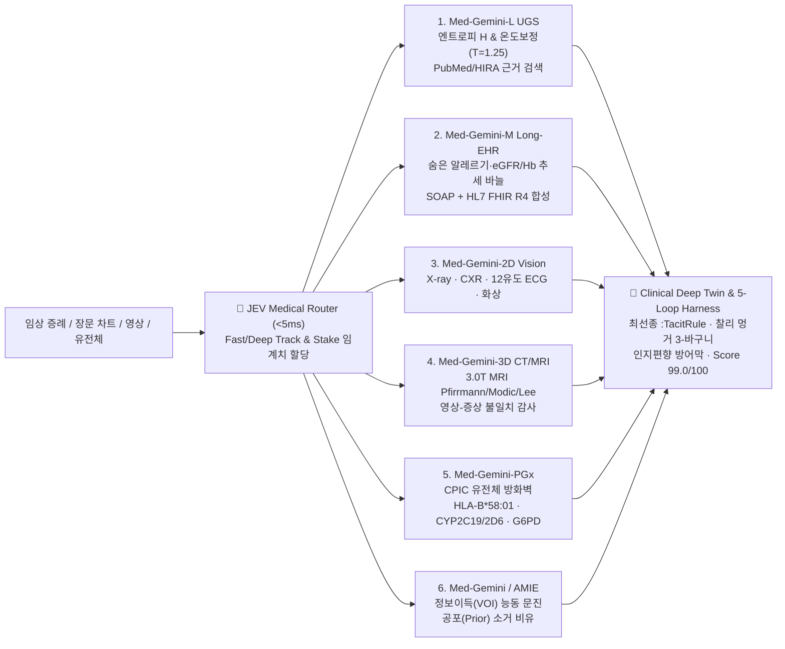

# 🏛️ Medi-Gemini Skill (`medi-gemini-skill` v6.0)
> **Full-Spectrum Neurosymbolic Medical AI Agent Skill: `JEV Router × Clinical Deep Twin × 0-Dependency Ontology`**  
> *Optimizing All 7 Google DeepMind Med-Gemini Capabilities (UGS · Long-Context EHR & FHIR · 2D/3D Medical Vision · CPIC Pharmacogenomics · AMIE VOI Dialogue · 99.0/100 Closed-Loop Harness)*

[](./LICENSE)
[](https://www.python.org/)
[](./SKILL.md)
[-10b981.svg)](./scripts/benchmark_assist_loop.py)
[](./scripts/medi_gemini_neurosymbolic_orchestrator.py)

---

## 📌 핵심 아키텍처 철학 (Why Neurosymbolic `JEV × Deep Twin × Ontology`?)

**`medi-gemini-skill` v6.0** 은 구글 딥마인드 **Med-Gemini 패밀리의 7대 의료 특화 기능 전체**를 단일 LLM 프롬프트에 의존하지 않고 **`JEV Medical Smart Router × Clinical Deep Twin × 0-Dependency SQLite/LLM-Wiki 온톨로지`** 신경기호학(Neurosymbolic) 삼위일체 아키텍처로 최적화한 자립형 에이전트 스킬입니다.

$$\text{Medi-Gemini v6.0} = \text{JEV Router}(x) \times \text{DeepTwin}_{\text{Tacit + 3-Basket}}(x) \times \mathbb{I}\!\left(\mathcal{C}_{\text{Ontology}}(y)=1\right)$$

> **⚖️ 필수 의료 안전 경계 (Physician-in-the-Loop Governance)**  
> 본 스킬의 모든 출력은 의료진의 임상 의사결정을 보조하는 **Clinical Assist 추론안**이며 의사의 대면 진찰, 최종 확정 진단 및 처방을 대체하지 않습니다. 응급 전원 기준, 환자 개별 상태, 최신 의약품 허가사항 및 보험·심사 기준에 따라 담당 전문의가 최종 결정합니다.

---

## 🔬 최적화된 Google Med-Gemini 7대 의료 특화 기능



1. **`Med-Gemini-L 1.5` — 불확실성 기반 근거 탐색 (`UGS`) & 베이즈 감별진단**: 샤논 엔트로피 $H(Y\mid X) \ge 0.85$ 감지 시 과잉확신을 억제하는 온도 보정($T=1.25$)과 함께 표적 PubMed/Cochrane/HIRA 검색 쿼리 및 Gemini Google Search Grounding을 가동합니다.
2. **`Med-Gemini-M 1.5` — 장문 종단 의무기록 바늘 검출 (`Needle-in-a-Haystack`) & `HL7 FHIR R4`**: 수년치 차트에 묻힌 설파제(Celecoxib 교차금기)·페니실린·조영제 알레르기, 연속 `eGFR` 하락, 잠복 출혈(`Hb` 저하)을 자동 포착하고 표준 `FHIR R4 Bundle`을 생성합니다.
3. **`Med-Gemini-2D Vision` — 2D 영상 · 12유도 심전도 · 피부/화상 판독**: 실제 이미지 파일(`--image`) 멀티모달 인코딩과 기호 임계치(`Cobb ≥ 10°`, 동적 전방전위 `≥ 4mm`, `CTR > 0.50`, 심전도 `ST 상승`/`Tent-T`/`QTc`)를 이중 검증합니다.
4. **`Med-Gemini-3D Volumetric` — 3.0T MRI / CT 정량 등급화 & 불일치 감사**: `Pfirrmann`, `Modic`, `Lee Grade 0~3`, 경추 척수 `T2 Myelomalacia`, 수술 후 경막외 혈종(`POSEH`)을 분석하고 **영상 우연종에 속지 않도록 피부분절 일치도를 감사**합니다.
5. **`Med-Gemini-PGx` — CPIC 약물유전체 정밀의학 방화벽**: `HLA-B*58:01`(Allopurinol 중증피부반응 절대금기), `HLA-B*15:02`(Carbamazepine 금기), `CYP2C19`(Clopidogrel 저항), `CYP2D6`(Codeine/Tramadol 위험), `CYP2C9`(Celecoxib/Warfarin 감량), `G6PD`(고용량 비타민C 수액 용혈 금기)를 결정론적으로 차단합니다.
6. **`Med-Gemini / AMIE` — 기대 정보이득(`VOI`) 능동 문진 & 환자 공포 소거 대화**: 진료실에서 가장 먼저 확인해야 할 핵심 질문과 5세 눈높이 인지 비유·비급여 동의 기록을 생성합니다.
7. **`Deep Twin × 5-Stage Closed-Loop Harness`**: 최선종 원장님의 `:TacitRule` 암묵지, **찰리 멍거 3-바구니(`YES` / `NO` / `TOO TOUGH`)**, **인지 편향 방어막(Anchoring·Premature Closure·Commission Bias 차단)** 및 8축 비평·교정 루프를 통해 **14대 임상 함정 벤치마크 14/14 (100.0%, `99.0/100점`)** 를 달성했습니다.

---

## 💻 설치 및 실행 방법 (Quick Start)

### 1. 1-Line 스킬 설치
```bash
git clone https://github.com/sunjongos/medi-gemini-skill.git
cd medi-gemini-skill
python install_skill.py
```

### 2. `JEV Router × Deep Twin × Ontology` 통합 실행
```bash
# 전체 7대 Med-Gemini 기능 통합 오케스트레이션 (--mode neurosymbolic)
python -X utf8 ndb_medi_gemini_agent.py --mode neurosymbolic --case "78세 남성, 좌측 L5 타는 듯한 방사통(VAS 8), eGFR 22, HLA-B*58:01 양성 및 설파 알레르기 병력, 동적 X-ray 전방전위 4.5mm, 세레콕시브·알로푸리놀 처방 문의"

# 2D/3D 의료 영상 멀티모달 판독 연동 (--image, --modality)
python -X utf8 ndb_medi_gemini_agent.py --mode neurosymbolic --case "63세 남성, 양손 저림 및 젓가락질 어눌함" --image sample_mri.png --modality mri

# 장문 EHR 바늘 검출 및 HL7 FHIR R4 번들 JSON 출력
python -X utf8 scripts/medi_gemini_neurosymbolic_orchestrator.py --case "만성 요통 및 통풍 재진" --ehr-file patient_history.txt --fhir

# 14대 다학제 임상 함정 벤치마크 & 전체 단위 테스트 실행
python -X utf8 ndb_medi_gemini_agent.py --benchmark
python -X utf8 -m unittest discover -s tests -v
```

---

## 📂 디렉터리 구조 (Repository Structure)

```text
medi-gemini-skill/
├── SKILL.md                                           # JEV × Deep Twin × Ontology 마스터 스킬 명세서 (v6.0)
├── README.md                                          # 아키텍처 · 7대 Med-Gemini 기능 · 사용 가이드
├── ndb_medi_gemini_agent.py                           # 통합 CLI 엔트리포인트 (neurosymbolic / loop / all / soap ...)
├── medi_gemini_knowledge.db                           # 0-Dependency 통합 온톨로지 SQLite DB (14개 핵심 테이블)
├── install_skill.py                                   # 1-Line 포터블 스킬 설치기
├── scripts/
│   ├── medi_gemini_neurosymbolic_orchestrator.py      # v6.0 JEV Router × Deep Twin × 7-Capability 오케스트레이터
│   ├── medi_gemini_assist_loop.py                     # 5단계 Closed-Loop 추론 · 약물 방화벽 · Critic-Refiner 엔진
│   ├── build_medi_gemini_db.py                        # 결정론적 온톨로지 & PGx/Vision/TacitRule DB 빌더
│   └── benchmark_assist_loop.py                       # 14대 다학제 임상 함정 벤치마크 스위트 (14/14 Pass)
├── wiki/
│   └── MOC_Medi_Gemini_Ontology.md                    # Karpathy 스타일 [[LLM-Wiki]] 지식그래프 인덱스
├── references/
│   └── clinical_assist_playbook.md                    # 6단 응답 표준 및 신기능·고위험 약물 방화벽 조견표
├── tests/
│   └── test_medi_gemini_assist_loop.py                # JEV · PGx · Long-EHR/FHIR · Vision · 14-Benchmark 테스트
└── dashboards/
    ├── NDB_Medi_Gemini_Clinical_Assist_Console.html   # 실시간 eGFR 방화벽 · 3×3 매트릭스 · SOAP 원클릭 콘솔
    ├── Choi_3x3_Pain_Matrix_Interactive_Dashboard.html
    └── NDB_Medi_Gemini_Medical_Ontology_Master.html
```

---

## 📄 License & Attribution
- **Clinical Deep Twin & Ontology Architecture**: Director Sun-Jong Choi, M.D., Ph.D. (Namyangju Baek Hospital)
- **Neurosymbolic JEV × Med-Gemini Engine**: Antigravity LUCA Agent Ecosystem
- **License**: MIT License ([LICENSE](./LICENSE))
