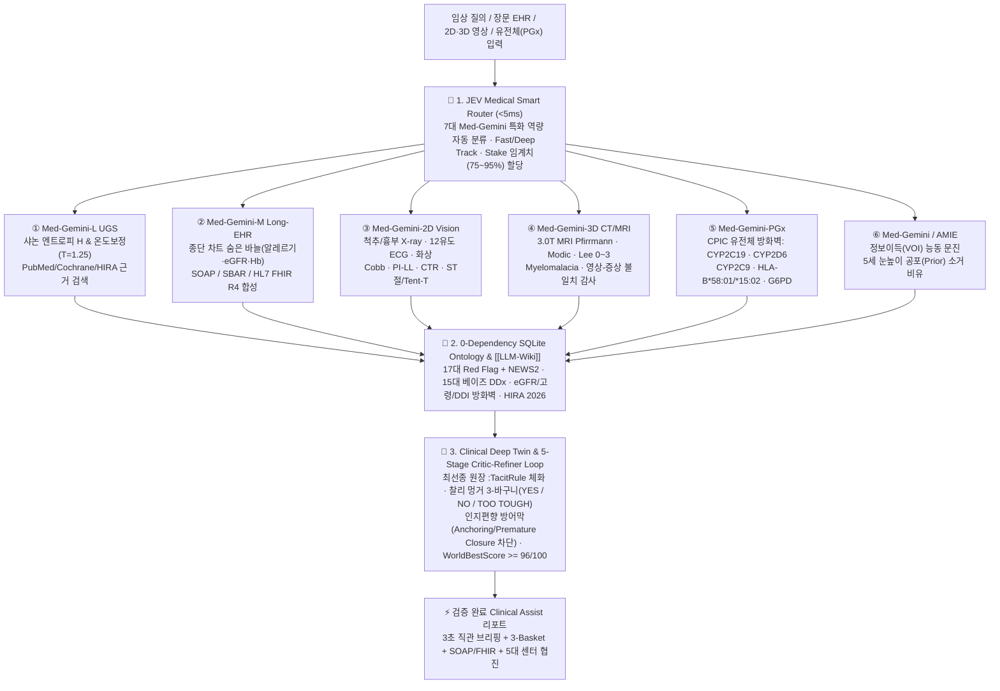

# 🏛️ Medi-Gemini v6.0 — `JEV Router × Deep Twin × Ontology` Neurosymbolic Medical Skill

> **Core Cognitive Formula**:  
> $$\text{Medi-Gemini v6.0} = \underbrace{\text{JEV Medical Router}}_{\text{7-Capability Intent & Stake Gate}} \times \underbrace{\text{Clinical Deep Twin}}_{\text{TacitRule + Munger 3-Basket + Bias Shield}} \times \underbrace{\text{0-Dependency Ontology}}_{\text{SQLite 14 Tables + [[LLM-Wiki]]}}$$

> **⚖️ 필수 의료 안전 경계 (Physician-in-the-Loop Mandate)**:  
> 본 스킬의 모든 출력은 담당 의료진의 진료를 보좌하는 **Clinical Decision Support / Assist** 추론안이며, 의사의 대면 진찰·최종 확정 진단·처방을 대체하지 않습니다. 응급 전원 기준, 환자 현재 상태, 최신 의약품 허가사항 및 보험·심사 기준에 따라 담당 전문의가 최종 결정합니다.

---

## 🏗️ 1. Neurosymbolic Triad Architecture (`JEV × Deep Twin × Ontology`)



---

## 🔬 2. 최적화된 Google Med-Gemini 7대 의료 특화 기능 전체 매핑

| 라우트 ID | Med-Gemini 특화 역량 | 핵심 구동 메커니즘 (Symbolic Left-Brain × Neural Right-Brain) |
| :--- | :--- | :--- |
| **`MG_ROUTE_01`** | **Rapid Emergency Triage** | **17대 Red Flag 킬스위치 + Royal College NEWS2** 즉시 판별(마미총, 수술후 혈종 `SMC ≤ 3`, 경추 기도혈종, ACS 10분 ECG, 뇌졸중 `BE-FAST`, 벼락두통 `SNOOP10`, 패혈증, 아나필락시스 외측 대퇴부 `Epinephrine IM`, `K+ > 6.0` 등) |
| **`MG_ROUTE_02`** | **Med-Gemini-L 1.5 (`UGS` & `DDx`)** | 사후확률 온도 보정($T=1.25$) 및 샤논 엔트로피 $H \ge 0.85$ 감지 시 **Uncertainty-Guided Search**(PubMed/Cochrane/HIRA 쿼리 및 실시간 Google Search Grounding) 발동 + `Must-Not-Miss` 배제진단 고정 |
| **`MG_ROUTE_03`** | **Med-Gemini-M 1.5 (`Long-EHR` & `FHIR`)** | 장문 종단 의무기록 내 **Needle-in-a-Haystack** 추출(숨은 설파제/페니실린/조영제 알레르기, 연속 `eGFR` 급감, 잠복 출혈 `Hb` 저하, 치료 불응력) + **HL7 FHIR R4 Bundle** 생성 |
| **`MG_ROUTE_04`** | **Med-Gemini-2D Vision** | 이미지 파일(`--image`) 멀티모달 판독 + 기호 임계치 교차검증(척추 `Cobb ≥ 10°`, 동적 전방전위 `≥ 4mm`, 흉부 `CTR > 0.50`, 12유도 심전도 `ST 상승`/`Tent-T`/`QTc > 500ms`, 저온화상 심도) |
| **`MG_ROUTE_05`** | **Med-Gemini-3D Volumetric CT/MRI** | 3.0T MRI `Pfirrmann 1~5`, `Modic Type 1~3`, `Lee Stenosis 0~3`, 경추 `T2 Myelomalacia`, `POSEH` 등급화 및 **영상 형태와 실제 피부분절 증상 간 불일치(Discordance) 감사** |
| **`MG_ROUTE_06`** | **Med-Gemini-PGx (정밀 약물유전체)** | **CPIC Level A 유전체 방화벽**: `HLA-B*58:01`(Allopurinol 중증피부반응 절대금기), `HLA-B*15:02`(Carbamazepine 금기), `CYP2C19`(Clopidogrel 저항), `CYP2D6`(Codeine/Tramadol 위험), `CYP2C9`(Celecoxib/Warfarin 감량), `G6PD`(고용량 비타민C 수액 용혈 금기) |
| **`MG_ROUTE_07`** | **Med-Gemini / AMIE Dialogue** | 기대 정보이득($\text{VOI}$) 순 능동 추가 문진 체크리스트 + 환자 공포(`Bayesian Prior`)를 낮추는 3+1 인지 비유 및 비급여 `[목적·한계·비용]` 설명·동의 기록 생성 |

---

## 👥 3. Clinical Deep Twin (`:TacitRule` × 찰리 멍거 3-바구니 × 인지편향 방어)

1. **찰리 멍거 3-바구니 결정 분리 (Munger 3-Basket)**:
   - 🟢 **`YES Basket (M=1)`**: 신장·유전체·지혈 안전이 검증된 보존/시간약리학(저녁 20시 `Duloxetine`, 취침 전 `Pregabalin`), `Balloon-PEN` 염증 세척, 후관절 보존 `BESS` 내시경 감압, 골든타임 응급 처치.
   - 🔴 **`NO Basket (M=0)`**: `eGFR < 30` 전신 NSAIDs·Duloxetine, PGx 금기 약물, 설하 Nifedipine, 감염 미배제 스테로이드 주사, 경추 척수증 도수교정, 마비 없는 급성 디스크 조기 유합술, 노시플라스틱 반복 주사.
   - 🟡 **`TOO TOUGH Basket (Physician Gate / DEFER_AND_VERIFY)`**: 감별 엔트로피 $H \ge 0.85$ 불확실 사례, 항혈전제 복용 환자의 침습 시술 휴약 결정, 장문 차트 내 숨은 알레르기/출혈 바늘 검출 사례 ➔ **단정 금지 후 `VOI` 최우선 검사 및 담당 전문의 결단 게이트로 이관**.
2. **인지 편향 방어막 (Cognitive Bias Shield)**:
   - 영상 우연종에 묶이는 **닻내림 편향(Anchoring Bias)**, 첫 인상으로 끝내는 **조기 종결(Premature Closure)**, 과잉 시술/수술을 부르는 **작위 편향(Commission Bias)**, AI의 **과잉확신 편향(Overconfidence)**을 결정론적으로 교정합니다.

---

## ⚡ 4. Mandatory Execution Protocol (CLI 실행 명령어)

모든 의료·임상 질의 시 **반드시 아래 Neurosymbolic 오케스트레이터를 선제 실행**하여 `JEV 라우팅 + 좌뇌 온톨로지 안전 방화벽 + Deep Twin 3-바구니 + 폐루프 검증` 근거를 확보한 뒤 응답하십시오.

```powershell
# 1. [권장 기본] JEV Router × Deep Twin × 7대 Med-Gemini 통합 오케스트레이터 실행 (--mode neurosymbolic)
python -X utf8 "c:\Users\USER\Desktop\luca연구에이전트\.agents\skills\ndb_medi_gemini_engine\ndb_medi_gemini_agent.py" --mode neurosymbolic --case "78세 남성, 좌측 L5 타는 듯한 방사통(VAS 8), eGFR 22, HLA-B*58:01 양성, 설파 알레르기 과거력, 동적 X-ray 전방전위 4.5mm, 세레콕시브·알로푸리놀 문의"

# 2. 멀티모달 2D/3D 의료 영상 파일 결합 판독 (--image, --modality)
python -X utf8 "c:\Users\USER\Desktop\luca연구에이전트\.agents\skills\ndb_medi_gemini_engine\ndb_medi_gemini_agent.py" --mode neurosymbolic --case "<증례>" --image "<영상파일경로>" --modality mri

# 3. 장문 종단 의무기록(Long-EHR) 바늘 탐색 및 HL7 FHIR R4 번들 추출 (--ehr-file, --fhir)
python -X utf8 "c:\Users\USER\Desktop\luca연구에이전트\.agents\skills\ndb_medi_gemini_engine\scripts\medi_gemini_neurosymbolic_orchestrator.py" --case "<증례>" --ehr-file "<차트경로>" --fhir

# 4. 세부 특화 모드 (--mode all | loop | triage | soap | ddx | matrix | plan | safety | explain | hira) & 벤치마크
python -X utf8 "c:\Users\USER\Desktop\luca연구에이전트\.agents\skills\ndb_medi_gemini_engine\ndb_medi_gemini_agent.py" --benchmark
python -X utf8 -m unittest discover -s "c:\Users\USER\Desktop\luca연구에이전트\.agents\skills\ndb_medi_gemini_engine\tests" -v
```

---

## 📂 5. Canonical Skill Container Files
- `scripts/medi_gemini_neurosymbolic_orchestrator.py`: **v6.0 마스터 오케스트레이터 (`JEV Router × Deep Twin × 7 Med-Gemini Capabilities`)**
- `scripts/medi_gemini_assist_loop.py`: 5단계 폐루프 임상 추론 · 약물 방화벽 · 8축 Critic-Refiner 엔진
- `scripts/build_medi_gemini_db.py` & `medi_gemini_knowledge.db`: 0-Dependency 통합 온톨로지 SQLite DB (14개 테이블)
- `ndb_medi_gemini_agent.py`: 통합 CLI 엔트리포인트 (`--mode neurosymbolic | loop | all | soap | triage ...`)
- `wiki/MOC_Medi_Gemini_Ontology.md`: Karpathy 스타일 `[[LLM-Wiki]]` 양방향 지식망 인덱스
- `references/clinical_assist_playbook.md`: 6단 응답 표준 및 신기능·약물 방화벽 조견표
- `dashboards/NDB_Medi_Gemini_Clinical_Assist_Console.html`: 실시간 eGFR 방화벽 · 3×3 매트릭스 · SOAP 복사 XAI 콘솔
